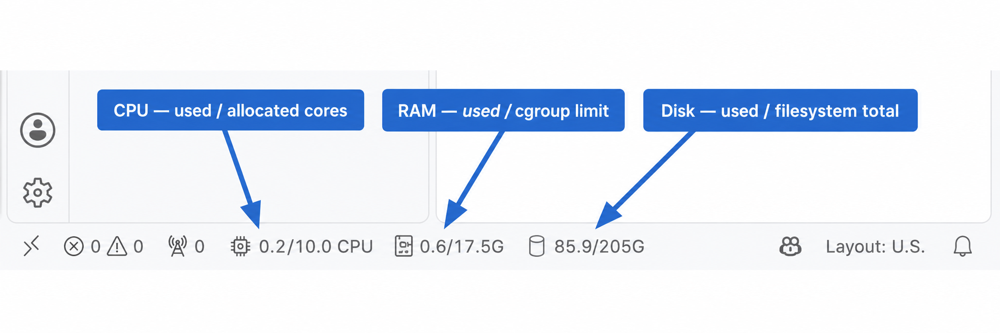

# Resource indicators in the status bar

CodeStation displays live resource usage at the bottom of VS Code. The values describe the current container or workspace, not the physical host.

## CPU

The chip indicator uses the format `used cores / allocated cores CPU`.

For example, `5.5/6.5 CPU` means the container is currently consuming approximately 5.5 CPU cores and its cgroup quota allows up to 6.5 cores. CPU consumption is sampled from cgroup accounting data.

## RAM

The memory-module indicator uses the format `used memory / memory limit` in GiB.

For example, `0.6/8G` means the container currently uses about 0.6 GiB from an 8 GiB cgroup memory limit.

## Disk

The storage indicator uses the format `used space / total space` in GiB.

For example, `4/6G` means 4 GiB are used on a 6 GiB filesystem. Disk values come from the filesystem containing the configured workspace path, `/home/coder` by default.

## More details

Move the pointer over any indicator to display precise values, remaining capacity, the disk path, and the last refresh time. Metrics refresh only while the VS Code window is focused to limit background resource usage.
